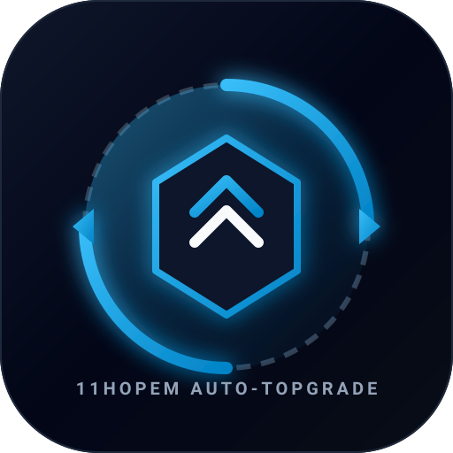

<!-- Created by 11Hopem -->
# Mac Auto Topgrade

<p align="center">
  
</p>

<p align="center">
  <strong>Autonomous macOS System & Developer Toolchain Maintenance Daemon</strong><br>
  <em>Unattended, safe, and lightning-fast developer environment upgrades triggered on every macOS boot.</em>
</p>

<p align="center">
  
  
  
  
  
</p>

---

## 1. Vision & Architecture Overview
**Mac Auto Topgrade** is an autonomous macOS background maintenance system engineered by **11Hopem**. Designed specifically for modern software engineers, it eliminates the cognitive overhead of manually running package updates across fragmented package ecosystems (Homebrew, npm, pipx, cargo, VS Code extensions, and system binaries).

Whenever macOS boots up or the user logs into their desktop session, the system's native `launchd` subsystem silently initializes the updater in the background:
- **Zero-Block Execution:** Safely bypasses `sudo` interactive password requirements and excludes OS-level restarts (`--disable system`).
- **Complete Isolation:** Strictly isolates developer tools from sensitive corporate repositories (`/Users/umut/intetra/*`), ensuring zero unintended git pulls or remote network activity on proprietary client workspaces.
- **Audited Telemetry:** Streams operational metrics and error diagnostics to Cloud Firestore (`hopem-software-cloud`) while maintaining 100% local JSON Lines data custody.
- **Native User Experience:** Dispatches native macOS User Notifications upon task initialization and completion with exact run duration.

---

## 2. Project Registry & Live Metadata

| Parameter | Value |
|---|---|
| **Author & Engineering Brand** | **11Hopem** ([https://11hopem.com](https://11hopem.com)) |
| **Contact Email** | `umutocgdr@gmail.com` |
| **GitHub Repository** | `https://github.com/umutocguder/mac-auto-topgrade` (Private) |
| **Cloud Firestore Ingestion** | `hopem-software-cloud` (`telemetry_logs` collection) |
| **Daemon Label** | `com.11hopem.mac-auto-topgrade` |
| **Target OS** | macOS Sonoma / Sequoia (Apple Silicon M-Series & Intel) |
| **Primary CLI Driver** | `/opt/homebrew/bin/topgrade` |

---

## 3. Core Capabilities & Modules

1. **Autonomous Boot Trigger (`com.11hopem.mac-auto-topgrade.plist`):**
   - Implements native Apple `launchd` configuration with `<key>RunAtLoad</key><true/>`.
   - Executes with background priority (`Nice: 10`, `ProcessType: Background`) preventing CPU throttle during boot.
2. **Hardened Package Safety Engine (`src/updater.py`):**
   - Automatically resolves binary paths across Homebrew defaults (`/opt/homebrew/bin/topgrade`, `/usr/local/bin/topgrade`).
   - Runs with `--yes --no-ask-retry --cleanup --disable system` flags.
   - Cleans up stale cache and downloaded installation archives.
3. **Native macOS Notification Gateway (`src/notification.py`):**
   - Uses AppleScript IPC (`osascript`) to deliver rich desktop notification banners with timestamps and status indicators.
4. **Cloud Firestore Live Telemetry (Rule 18 / `src/telemetry.py`):**
   - Transmits start, success, and error events via HTTP POST to Firestore REST endpoints.
   - Guarded by non-blocking timeouts to guarantee zero failure propagation when offline.
5. **Rotary SHA-256 Backup Vault (Rule 17 / `scripts/backup.py`):**
   - Maintains rolling `.tar.gz` snapshots of execution logs with cryptographic SHA-256 manifest verification.

---

## 4. Directory & Component Architecture

```
/Users/umut/mycodespaces/mac-auto-topgrade/
├── AGENTS.md                               # Project development instructions & boundaries
├── CLAUDE.md                               # AI synchronization pointer (@AGENTS.md)
├── WORKLOG.md                              # AI Handoff-ready progress & audit ledger
├── README.md                               # Comprehensive documentation
├── .gitignore                              # Clean repository filters
├── com.11hopem.mac-auto-topgrade.plist      # macOS LaunchAgent daemon definition
├── .github/
│   └── workflows/
│       └── ci-cd.yml                       # Autonomous test, lint, and release pipeline
├── assets/
│   ├── images/
│   │   └── logo.svg                        # 11Hopem cyber-blue vector emblem
│   └── icons/
│       └── favicon.svg                     # High-DPI icon asset
├── scripts/
│   ├── run_updater.sh                      # LaunchAgent executable entrypoint
│   ├── install_launchagent.sh              # One-command daemon registration
│   ├── uninstall_launchagent.sh            # Complete uninstaller & cleanup
│   ├── status.sh                           # Live service & log diagnostics
│   └── backup.py                           # Rule 17 SHA-256 rolling backup engine
├── src/
│   ├── __init__.py                         # Package definition & metadata
│   ├── updater.py                          # Core topgrade runner & process controller
│   ├── notification.py                     # Native AppleScript notification dispatch
│   └── telemetry.py                        # Cloud Firestore REST event streamer
├── data/
│   ├── runs.json                           # Rolling historical run ledger
│   └── telemetry_logs.jsonl                # 100% local custody audit events
└── tests/
    ├── __init__.py
    ├── test_updater.py                     # Unit tests for runner and safety flags
    ├── test_notification.py                # Unit tests for notification dispatch
    ├── test_telemetry.py                   # Unit tests for Firebase payload & offline state
    └── test_backup.py                      # Unit tests for backup engine & SHA-256 digests
```

---

## 5. Security, Isolation & Compliance Shield

- **Zero Sudo Hang:** Topgrade never triggers interactive `sudo` prompts that could block boot completion. The OS-level update step (`system`) is explicitly disabled in unattended mode.
- **Zero Corporate Interference:** Adheres strictly to **Rule 1 (Confidentiality & Corporate Boundary)**. Corporate git trees (`/Users/umut/intetra/*`) are completely untouched and isolated from auto-fetch or auto-pull commands.
- **Local Data Custody:** In compliance with data privacy principles, every execution log and telemetry event is persisted locally on the machine before any cloud dispatch.

---

## 6. Installation & Service Management

### Step 1: Install and Register the Daemon
To install the LaunchAgent into your macOS user session:
```bash
bash scripts/install_launchagent.sh
```
*The daemon is now registered in `~/Library/LaunchAgents/` and will automatically execute every time your Mac boots or you log in.*

### Step 2: Verify Status
To check if the daemon is registered and review the last execution status:
```bash
bash scripts/status.sh
```

### Step 3: Run Manual Maintenance
To trigger a manual run immediately without rebooting:
```bash
bash scripts/run_updater.sh
```
Or test in simulation mode without making changes:
```bash
python3 src/updater.py --dry-run
```

### Step 4: Uninstalling
To stop and remove the LaunchAgent:
```bash
bash scripts/uninstall_launchagent.sh
```

---

## 7. Testing & Quality Assurance

All features are covered by automated unit tests requiring zero external dependencies:
```bash
# Run all tests
python3 -m unittest discover -s tests -p "test_*.py" -v

# Run backup verification
python3 scripts/backup.py
```

---

## 8. Brand Attribution & Legal Künye

- **Created by:** [11Hopem](https://11hopem.com)
- **Copyright:** &copy; 2026 11Hopem. All rights reserved.
- **Official Domain:** [https://11hopem.com](https://11hopem.com)
- **License:** 11Hopem Proprietary Software License.
